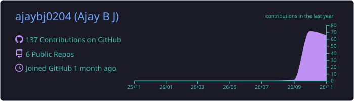
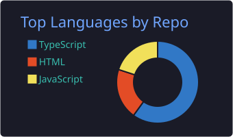
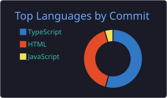
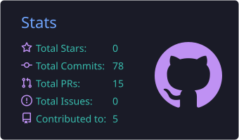
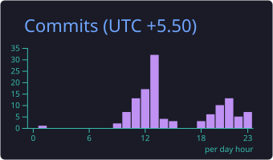

  

  

  
  
  
  

---

## 🧑‍💼 About Me

I'm a Bengaluru-based **business and payments operations** professional with **2+ years in fintech** at **Razorpay** and **G2 Risk Solutions**. I combine that operational know-how with data and AI-assisted development to build dashboards, automations and working products.

- 💳 POS merchant onboarding for bank partners, MID/TID management, **KYC/AML** and risk checks, transaction monitoring and **reconciliation**
- 📊 Turning operations data into answers with **SQL, Excel, Power BI and Python**
- 🤖 Building full-stack products with **Next.js, Supabase and AI**, from the spec and business rules to testing and launch
- 🎓 BE, Information Science & Engineering, New Horizon College of Engineering (2024)
- 🎯 Open to **Business Operations, Payments Operations, Business Analyst and Data Analyst** roles in Bengaluru
- ⚡ I like turning messy processes into simple tools people actually use

---

## 🛠️ Tech Stack

  

  
  
  
  
  
  
  
  

---

## 🚀 Featured Projects

| Project | What it is | Built with | Links |
|---|---|---|---|
| **🧭 CareerFlow AI** | AI job-search platform: reads Gmail (read-only) and tracks every application automatically, tailors resumes truthfully, and fills application forms through a Chrome extension | Next.js, Supabase, Gmail API, Gemini, GitHub Actions | [Live](https://careerflow-ajaybj.vercel.app) · [Code](https://github.com/ajaybj0204/careerflow-ai) |
| **🍛 Mane & Oggarane** | Restaurant ordering and customer-retention platform: menu to checkout to Razorpay to kitchen dashboard, with rewards and delivery rules | Next.js, Supabase, Razorpay, Google OAuth | [Demo](https://mane-oggarane-demo.vercel.app) · [Code](https://github.com/ajaybj0204/mane-oggarane-staging) |
| **💪 FITORA** | Full-stack fitness app: smart workout logger that suggests next weights, Gemini AI coach and Indian food logging, phone reminders, gym owner tools (fees, WhatsApp/UPI links, QR check-in, reports), Android app, 5 languages | React, TypeScript, Firebase (Auth, Firestore, FCM), Gemini, Vercel functions, Android TWA | [Live](https://fit-mate-coral.vercel.app) · [Code](https://github.com/ajaybj0204/FitMate) |
| **🌐 Portfolio** | My portfolio with case studies, a data lab and animated UI | Next.js, TypeScript, Tailwind | [Live](https://ajay-bj-portfolio.netlify.app) · [Code](https://github.com/ajaybj0204/ajay-portfolio) |

---

## 📊 GitHub Overview

  

  
  

  
  

Cards are generated in this repo every day by a GitHub Action, so they never depend on an outside service being up.

---

## 🐍 Contribution Activity

  <picture>
    <source media="(prefers-color-scheme: dark)" srcset="https://raw.githubusercontent.com/ajaybj0204/ajaybj0204/output/github-snake-dark.svg" />
    <source media="(prefers-color-scheme: light)" srcset="https://raw.githubusercontent.com/ajaybj0204/ajaybj0204/output/github-snake.svg" />
    
  </picture>

---

## 🤝 Connect With Me

  
  
  
  

<b>Let's build something useful together.</b>

  

